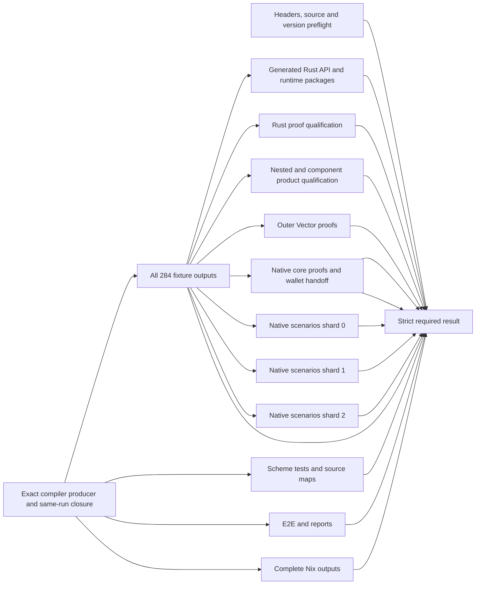

# Compiler CI test graph

Status: implementation and hosted qualification for
[#708](https://github.com/betsudo/compact/issues/708), 2026-11-06. Base:
`codex/rust-backend-ast` at `9dc8d22b67eda0a90a8e99950556ef64b4e6f986`.
The implementation is published as draft stacked PRs
[#709](https://github.com/betsudo/compact/pull/709) through
[#715](https://github.com/betsudo/compact/pull/715). The consolidated
[#716](https://github.com/betsudo/compact/pull/716) is in hosted qualification;
the independent workspace/product owner split is a local follow-up candidate.

## Implemented graph and measured result

The Linux producer still publishes the exact same-run authenticated compiler
closure. Source/header preflight runs alongside it. Full 284-fixture freshness,
Scheme compiler/source maps, default Nix package outputs and E2E/report uploads
run after the producer. The fixture check gates native, proof and runtime
qualification, so a stale fixture fails before those expensive consumers.
Native qualification has a shared wallet/negative-control owner and three
measured named-scenario shards. Outer Vector proofs have their own owner. A
strict `Build and test compiler` job requires every owner and all shards.

The complete [#713 hosted run](https://github.com/betsudo/compact/actions/runs/42134457505)
passed in 77.57 minutes wall time and 178.95 summed runner minutes. Its long
proof/runtime owner took 57.75 minutes after producer and fixture checks. The
[#714 run](https://github.com/betsudo/compact/actions/runs/42138149437)
also passed after outer Vector isolation: 72m54s end to end, with the remaining
proof/runtime owner at 48m58s and the native/wallet owner at 52m49s. These are
different source SHAs under overlapping hosted load, so the difference is
indicative rather than a controlled speedup. The three-shard
[#715 run](https://github.com/betsudo/compact/actions/runs/42143738114)
also passed: 64m53s wall time and 270.47 summed successful runner minutes.
All 26 named selectors passed exactly once. Its full fixture scan took 5m42s
after a 14m28s producer. The remaining proof/runtime owner took 42m24s and the
shared native wallet/control owner set the path at 44m28s. The additional
shards raised runner use by 71.37 minutes versus #714; source SHAs and hosted
load differed, so this is an indicative comparison.

The #716 slice gives generated Rust API, capability, workspace tests, Clippy
and runtime package checks an independent owner. The native wallet owner runs
the original handoff in `--wallet-only` mode; the default local native script
still runs its complete command list. Repeated capability and Clippy commands
are owned once in the API lane, and proof qualification remains separate. All
required tests and diagnostic artifacts retain an owner. This split is a
candidate until hosted timing and complete-gate parity pass. Its first hosted
run showed the API owner's workspace Cargo test taking 16m18s after its other
checks, so the local follow-up gives workspace tests and Clippy a separate
compiler-independent owner that can start with the producer. The same follow-up
moves the final four product qualification commands into their own owner after
full fixture freshness. These changes require a complete hosted gate before
any timing claim.

## Evidence

The [PR #705 failed run](https://github.com/betsudo/compact/actions/runs/42081471310)
started the Linux compiler producer and header check together. The producer
finished in 14.2 minutes. One consumer job then ran for 129.2 minutes and
failed because `tests-rust-backend/test-center-welcome/lib.rs` was stale. The
fixture check was inside `check_native_ci.sh`, after roughly 42 minutes in that
step and after many unrelated checks. Every subsequent proof, runtime and E2E
step was skipped. A preceding [successful run](https://github.com/betsudo/compact/actions/runs/42054647866)
spent 15.2 minutes in the producer and 138.9 minutes in the consumer.

Selected consumer times from the failed run: default Nix outputs 7.3 min,
compiler tests 18.9 min, outer Vector proofs 11.0 min, constructor Vector proofs
28.9 min, native backend gate 42.4 min before its fixture failure. In the
successful run, the complete native gate took 57.3 min. These are wall times
of whole steps, not isolated key generation or CPU profiles.

The compiler producer is **already** a reusable workflow with a same-run,
SHA-bound Nix closure artifact. The consumer imports it in about one minute.
The default `nix build` still realizes `compactc`, ZKIR2, ZKIR3 and the VS Code
extension together. Each consumer should request only its demonstrated
prerequisites; existing packaging checks retain an explicit owner.

Two local spikes on this branch used the existing realized compiler
`/nix/store/j6yi0krjr0vqhrbwn090mqik7k4cxwd1-compactc` (version 0.31.193):

| Check | Result | Wall time |
| --- | --- | ---: |
| Fixture-checker unit tests | 4 passed | 0.02 s |
| Pinned oracle inventory | 37 sources, 0 failed | under 1 s |
| `check_fixture_outputs.py --only welcome.compact` | 1 fresh fixture | 0.89 s |
| Same checker with `counter.compact` and `bboard.compact` | 3 fresh fixtures total | 1.57 s |

The base revision is fresh; this is not a reproduction of the PR-head defect.
It proves the existing checker can isolate concrete contracts cheaply after
compiler availability. The full 284-fixture scan remains required in a
separate freshness lane until changed-source selection is complete and proven.

## Dependency graph

The independent workspace and product owners are local candidates, not yet
hosted-qualified.
Source checks run while the producer builds. Scheme compiler tests still use
its closure and begin after it. Every native/proof consumer requires the full
fixture owner; each has its own verified proof material where required. The
native scenario matrix uses `fail-fast: false` so every shard reports.

## Test inventory and scheduling

First inventory the commands and cases that actually run. Create a checked-in
manifest only where it improves selection and parity checking. Each entry needs
a stable ID, exact command/selector, source and fixture paths, owning lane,
actual prerequisite artifacts, mutable outputs, and measured P90 duration and
peak memory. Reject duplicate IDs, unowned cases and coverage drift. Record
tool versions and ledger protocol as exact environment requirements where they
matter, without making speculative version tags part of the scheduler.

Choose job boundaries by shared setup, artifact handoff and failure domain:
source consistency, compiler/Scheme, generated API and fixture freshness,
proof/application, and runtime/E2E. A contract can have several distinct
checks. Balance proof shards using measured duration and memory within their
real dependencies. Numeric durations are more useful than `quick`/`long` tags;
no `ledger8`/`ledger9` or `zkir2`/`zkir3` taxonomy is adopted by this plan.

Start with the existing `--only` fixture selector and the existing
`check_compactc_target.py` contract selectors. Keep one full inventory lane to
prove no contract was dropped. Split `check_native_ci.sh` by extracting its
exact command list into owned phases, with explicit wallet handoff artifacts
and private output directories. Do not split the script by invoking it in
several jobs unchanged: it would repeat the entire gate and share mutable
targets. Proof shards need isolated `CARGO_TARGET_DIR`, output roots and
parameters, or one prebuilt proof-runner artifact with verified identity. The
illustrated shard count is a candidate to test, not a fixed contract grouping.

## Cache and artifact policy

Use the same-run authenticated compiler closure as the producer artifact,
never a cross-run cache hit as a substitute for the current compiler. Keep
Attic/content-addressed Nix substitution for Nix outputs. Add narrowly keyed
GitHub caches for Cargo registry/git downloads, locked fixture archives and
public parameters; include platform, architecture, exact Rust/tool versions,
lockfile and profile/features as applicable. Cache compiled Cargo outputs only
after comparing restore/upload time and size against rebuilding. Never cache
test verdicts, generated mutable fixtures, secrets or proof success. Every
restored binary or parameter used for proof qualification must retain its
current hash/provenance check. Preserve the existing uncached qualification.

## Delivery and acceptance

1. Emit per-phase and per-contract timing, peak RSS and cache hit/transfer
   metrics in CI. Save a JSON timing report even on failure. Record the exact
   source SHA, compiler artifact ID and each shard's case inventory.
2. Move full fixture freshness into its own job immediately after the producer.
   Add a changed-source `--only` preflight for faster diagnosis, but keep the
   full scan. Separate the broad Nix output realization from compiler tests.
3. Extract a native API/fixtures/proof split and prove command/case parity
   against the current script. Trial 2–3 proof shards only after measuring
   shared setup, P90 wall time and memory. Keep current proof/strict application
   and negative controls intact.
4. Run the owner jobs in parallel, preserve named required checks and a strict
   aggregator. Compare at least three warm and one cold hosted runs at the
   same SHA and runner class. Include cost and artifact/cache transfer time.

The first milestone is a complete PR gate under 60 minutes, with earlier
failure feedback for stale fixtures. A 20–30 minute complete gate is a stretch
target: the observed 14–15 minute compiler producer and 19-minute compiler
tests leave little serial budget. It requires overlap, proof sharding and
measured cache/transfer wins. Do not claim it from a theoretical max-of-steps
calculation or shorten the gate by omitting required tests.
