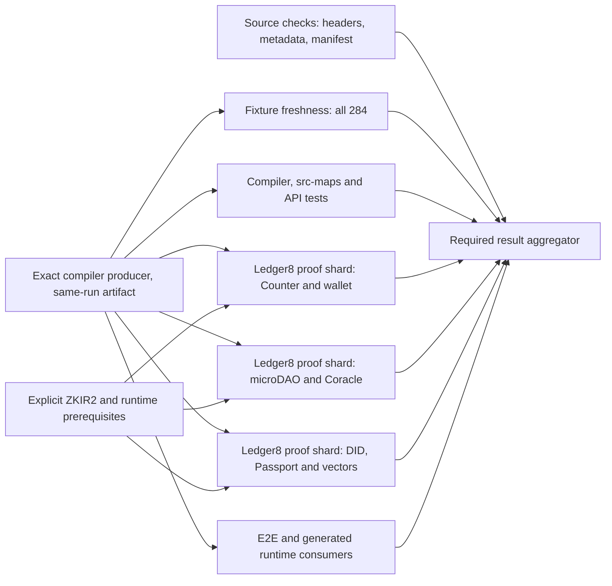

# Compiler CI test graph proposal

Status: investigation for [#708](https://github.com/betsudo/compact/issues/708),
2026-11-06. Base: `codex/rust-backend-ast` at
`9dc8d22b67eda0a90a8e99950556ef64b4e6f986`. This plan changes no gate.

## Evidence

The [PR #705 failed run](https://github.com/betsudo/compact/actions/runs/42081471310)
started the Linux compiler producer and header check together. The producer
finished in 14.2 minutes. One consumer job then ran for 129.2 minutes and
failed because `tests-rust-backend/test-center-welcome/lib.rs` was stale. The
fixture check was inside `check_native_ci.sh`, after roughly 42 minutes in that
step and after many unrelated checks. Every subsequent proof, runtime and E2E
step was skipped. A preceding [successful run](https://github.com/betsudo/compact/actions/runs/42054647866)
spent 15.2 minutes in the producer and 138.9 minutes in the consumer.

Selected consumer times from the failed run: default Nix outputs 7.3 min,
compiler tests 18.9 min, outer Vector proofs 11.0 min, constructor Vector proofs
28.9 min, native backend gate 42.4 min before its fixture failure. In the
successful run, the complete native gate took 57.3 min. These are wall times
of whole steps, not isolated key generation or CPU profiles.

The compiler producer is **already** a reusable workflow with a same-run,
SHA-bound Nix closure artifact. The consumer imports it in about one minute.
The default `nix build` still realizes `compactc`, ZKIR2, ZKIR3 and the VS Code
extension together. The compiler lane should instead request only the outputs
it needs; editor and ZKIR3 validation keep separate owners.

Two local spikes on this branch used the existing realized compiler
`/nix/store/j6yi0krjr0vqhrbwn090mqik7k4cxwd1-compactc` (version 0.31.193):

| Check | Result | Wall time |
| --- | --- | ---: |
| Fixture-checker unit tests | 4 passed | 0.02 s |
| Pinned oracle inventory | 37 sources, 0 failed | under 1 s |
| `check_fixture_outputs.py --only welcome.compact` | 1 fresh fixture | 0.89 s |
| Same checker with `counter.compact` and `bboard.compact` | 3 fresh fixtures total | 1.57 s |

The base revision is fresh; this is not a reproduction of the PR-head defect.
It proves the existing checker can isolate concrete contracts cheaply after
compiler availability. The full 284-fixture scan remains required in a
separate freshness lane until changed-source selection is complete and proven.

## Proposed graph

The source checks and Scheme compiler tests can begin while the producer is
running when they do not consume its artifact. Only genuine producer consumers
get a `needs` edge. Use named jobs or small reusable workflows for owners;
keep the final aggregator tiny and require each owner to report success. Use
`fail-fast: false` for proof matrices so an unrelated shard still reports.

## Test manifest and categories

Create a checked-in manifest with one row per suite or contract, containing
stable ID, command, source/fixture paths, owner, prerequisite outputs, tags,
expected duration, memory class and artifact policy. Reject duplicate IDs,
unknown tags, unowned tests and coverage drift in a fast manifest check.
Tags are orthogonal, not a single mutually exclusive bucket:

| Axis | Initial values | Rule |
| --- | --- | --- |
| Ledger | `ledger8`, `ledger9` | Current proof work is `ledger8`; add `ledger9` only with an actual fixture/toolchain. |
| ZKIR | `zkir2`, `zkir3` | Current proof lane uses actual `zkir`; distinguish the selected version explicitly. ZKIR3 gets its own qualification lane. |
| Surface | `compiler`, `api`, `source-map`, `fixture`, `proof`, `runtime`, `e2e`, `editor` | A contract may have API, freshness and proof rows with distinct commands. |
| Duration | `quick`, `long` | Set by measured P90, e.g. quick under 2 min, then rebalance from timings. |

Start with the existing `--only` fixture selector and the existing
`check_compactc_target.py` contract selectors. Keep one full inventory lane to
prove no contract was dropped. Split `check_native_ci.sh` by extracting its
exact command list into owned phases, with explicit wallet handoff artifacts
and private output directories. Do not split the script by invoking it in
several jobs unchanged: it would repeat the entire gate and share mutable
targets. Proof shards need isolated `CARGO_TARGET_DIR`, output roots and
parameters, or one prebuilt proof-runner artifact with verified identity.

## Cache and artifact policy

Use the same-run authenticated compiler closure as the producer artifact,
never a cross-run cache hit as a substitute for the current compiler. Keep
Attic/content-addressed Nix substitution for Nix outputs. Add narrowly keyed
GitHub caches for Cargo registry/git downloads, locked fixture archives and
public parameters; include platform, architecture, exact Rust/tool versions,
lockfile and profile/features as applicable. Cache compiled Cargo outputs only
after comparing restore/upload time and size against rebuilding. Never cache
test verdicts, generated mutable fixtures, secrets or proof success. Every
restored binary or parameter used for proof qualification must retain its
current hash/provenance check. Keep the uncached key-generation qualification
while measuring Forge or other key reuse separately.

## Delivery and acceptance

1. Emit per-phase and per-contract timing, peak RSS and cache hit/transfer
   metrics in CI. Save a JSON timing report even on failure. Record the exact
   source SHA, compiler artifact ID and each shard's case inventory.
2. Move full fixture freshness into its own job immediately after the producer.
   Add a changed-source `--only` preflight for faster diagnosis, but keep the
   full scan. Separate the broad Nix output realization from compiler tests.
3. Extract a native API/fixtures/proof split and prove command/case parity
   against the current script. Start with 2–3 proof shards; rebalance by P90
   wall time and memory, not source count. Keep Ledger8 proof/strict application
   and negative controls intact.
4. Run the owner jobs in parallel, preserve named required checks and a strict
   aggregator. Compare at least three warm and one cold hosted runs at the
   same SHA and runner class. Include cost and artifact/cache transfer time.

The first milestone is a complete PR gate under 60 minutes, with earlier
failure feedback for stale fixtures. A 20–30 minute complete gate is a stretch
target: the observed 14–15 minute compiler producer and 19-minute compiler
tests leave little serial budget. It requires overlap, proof sharding and
measured cache/transfer wins. Do not claim it from a theoretical max-of-steps
calculation or shorten the gate by omitting required tests.
