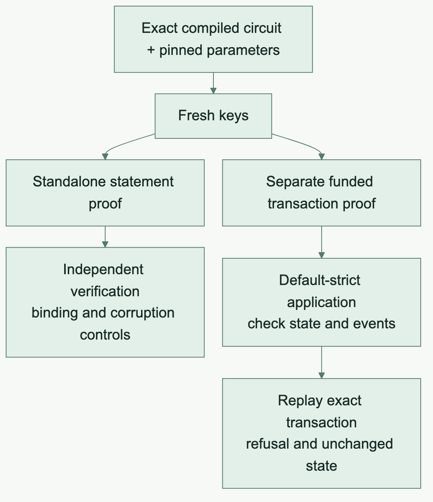

## Follow one circuit all the way

The pipeline explorer shows eight stages. Each stage has an owner, a useful output and a failure that the next stage can expose.

### Source admission

The frontend checks Compact syntax, types, disclosure and supported target capabilities. A newer language pragma may fail before a circuit is considered. A derivative with that pragma removed is useful for investigating semantics, with its changed source identity recorded explicitly.

### Typed lowering and Rust emission

The internal IR preserves types and operations, and carries source origins where the frontend supplies them. Checked lowering establishes a Rust representation and legal control flow. Syntax emission renders the admitted model. Generated code compilation catches Rust-level errors in the public API. Structural and type checks do not establish source semantic equivalence. A same-typed operand or slot substitution needs an independent behavioral observation.

### Native execution

Execute the generated function against the selected ledger runtime. Compare returns, state, witnesses, private state and gas with an independent reference case.

### Recorded execution and replay

Record the same admitted effects and replay them through the ledger VM. Compare the resulting state and ordered observations. Losing a Unit-valued effect can be detected here even when the return value looks harmless.

### SDK preflight

Interpret the exact ZKIR against the serialized preimage. Check its raw identities and compare input, output, public transcript and private transcript fields. Mutated statements should be refused when they violate the original circuit.

### Fresh standalone proof and verification

Generate the selected keys from pinned parameters and exact IR. Produce a new proof. Verify in an independent process with the verifier rederived from those identities. Exercise wrong-verifier, changed-binding and corrupt-proof controls.

### Funded transaction

Construct a separate transaction-bound proof. Preserve the observed installed operation. Include genuine fee funding and default-strict ledger verification. Compare the applied state and events to generated native execution.

### Replay and rollback

Apply the same verified transaction again. The accepted result in the selected lanes is IntentAlreadyExists with unchanged whole-ledger bytes and no repeated events. A broader transaction failure may also require rollback tests.

## Before and after · What does “the proof passed” tell you?

### Before · Verify one statement in isolation

For Counter, a valid standalone proof established its selected statement. The transaction prover still exposed the missing skip entries described in the Ledger 9 chapter.

### After · Test the two paths separately

[Mermaid source](../assets/diagrams/proof-lanes.mmd)

| Test | What the reader can look for |
| --- | --- |
| Verify the standalone proof | The verifier, bindings and proof bytes match the intended statement. |
| Prove and apply a funded transaction | The ledger accepts the transaction under default strictness and reaches the expected state. |
| Submit the same transaction again | The ledger refuses the replay and leaves the state unchanged. |

## Why compile-fail tests belong in the guide

The generated Rust API should reject invalid ordinary use at compile time where the type system can express the constraint. Passing a P-256 carrier to a K1 method is one example.

Unknown bytes, installed verifier material and decoded protocol data cross untrusted boundaries. Those inputs need explicit diagnostics and runtime errors. A useful API makes that distinction predictable.

## A review checklist

- Identify the exact source, compiler, backend, runtime and SDK family.
- Check the affected ordinary entry points, including previously generated consumers.
- Inspect positive behavior and the most relevant invalid-use controls.
- Bind raw IR, generated library, keys, parameters and immutable verifier identity.
- Read the actual application and replay receipts.
- State the platform and the source revision for every aggregate count.

### Source trail

- [Proof integration guide](https://github.com/betsudo/compact/blob/05912594fa3c483cf4e7031de83c5f9a103ef95c/doc/rust/guides/proof-integration.md)
- [Ledger 9 adoption plan snapshot](../sources/ledger9-adoption.md)
- [Coverage issue #727](https://github.com/betsudo/compact/issues/727)
