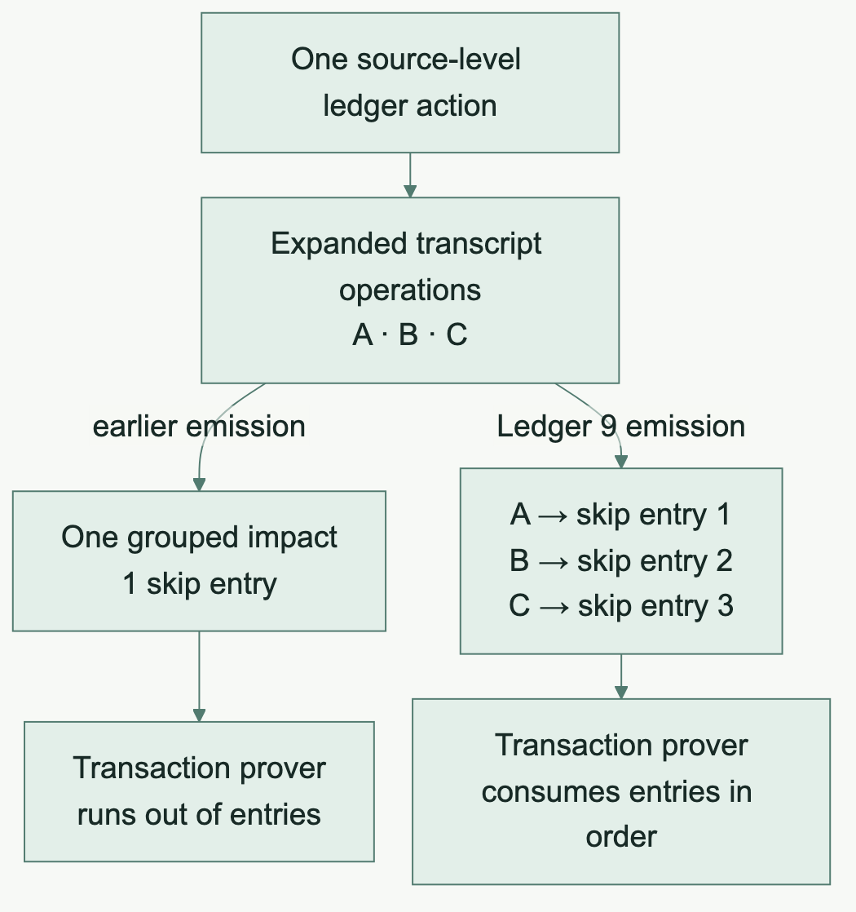

## Why a branch boundary mattered

Ledger 9 adoption began on a dedicated line so the Ledger 8 implementation and its evidence remained available. Changing a dependency family can affect state tags, serialization, gas, proof version, fee material, transaction APIs and installed operations.

Rust source compilation alone would establish only a small part of that migration.

## The dependency and ABI contract

The runtime adopted the published Ledger 9.1.0.1 package set. The compiler/runtime pairing moved to ABI 54, ordinary Rust generation selected ZKIR v3, and the workspace and Nix Rust tools moved to Rust 1.99.0.

The synchronous local Compact runtime used minor 0.17.0 with Onchain Runtime 4.0.1. Released Compact 0.36.0 used its own asynchronous runtime pairing. Comparing them required matching captures and explicit adapters, with cross-version refusal controls.

## A failing transaction exposed an emitter bug

The initial standalone Counter proof passed, but transaction proving exhausted its skip entries. The earlier emitter grouped expanded ledger operations into one impact. Ledger 9 consumes a skip entry for each transcript operation.

The repair preserved those boundaries and omitted suppressed operations. The Counter's three impacts then matched the released reference. This is a particularly useful migration lesson. A proof result from an isolated statement can pass while the transaction consumer exposes an incompatibility in the same generated circuit.

## Before and after · Count the steps the prover reads

### Before · Count one source action

Imagine one action expanding into three transcript operations, A, B and C. Grouping them together emitted one impact and provided one skip entry. The transaction prover consumed that entry for A and still needed entries for B and C.

### After · Count each emitted operation

Emit one impact per active operation and omit suppressed operations. The repaired Counter had three impacts and matched the released reference. The lettering below explains the mapping without abbreviating the actual Counter transcript into invented instructions.

[Mermaid source](../assets/diagrams/ledger9-skips.mmd)

## Funding is part of the test

The Ledger 9 lane used released dust/10/spend material. The retained Ledger 8 dust/9/spend material belonged to the historical line. The contract verifier and the Dust verifier also serve different roles.

The qualified Counter run generated fresh keys and a standalone proof. A separate process verified that proof and refused changed bindings, commitment, wrong verifier and corrupt bytes. A separately proved, Dust-funded transaction then passed default strictness, applied the expected state and refused exact replay with unchanged ledger bytes.

## The integrated local result

At frozen source 9409b7da1cc652940469903a8380000b0b707239, the full local parity gate on macOS arm64 with Rust 1.99.0 checked 286 fixtures and bound 87 generated consumers to their executed artifacts. Checked recording was observed for 688 selected exports, including 626 proof-eligible exports.

Nine child proof gates passed for 87 selected calls. Those counts overlap across gates and belong to that frozen revision. They are not an aggregate count of every later compatibility proof.

## Foundation publication

PR #725 merged on November 12. The publication and CI repair history belongs to that PR. The extensive subsequent upstream ports remained a separate local compatibility milestone.

The book therefore marks the foundation as merged and the later corpus work as local qualification. It makes no new claim about every final-head CI result from a historical local receipt.

### Source trail

- [Migration PR #725](https://github.com/betsudo/compact/pull/725)
- [Merged foundation](https://github.com/betsudo/compact/commit/05912594fa3c483cf4e7031de83c5f9a103ef95c)
- [Ledger 9 foundation source](https://github.com/betsudo/compact/commit/9fb0ca9c7c7e075461d3122b9f606a00c88de06a)
- [Current compatibility issue #726](https://github.com/betsudo/compact/issues/726)

The frozen initial full receipt has SHA-256 12ee47fd5280d03c3c708553034d0bd35976e0f682a0810f9cf4866d8b497746. Its public summary is retained in this book's source snapshots.
