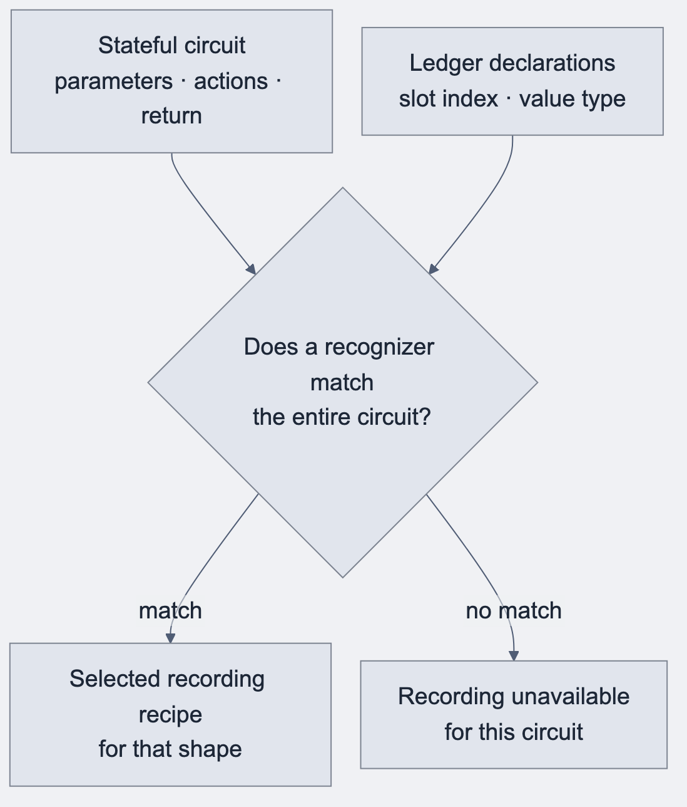
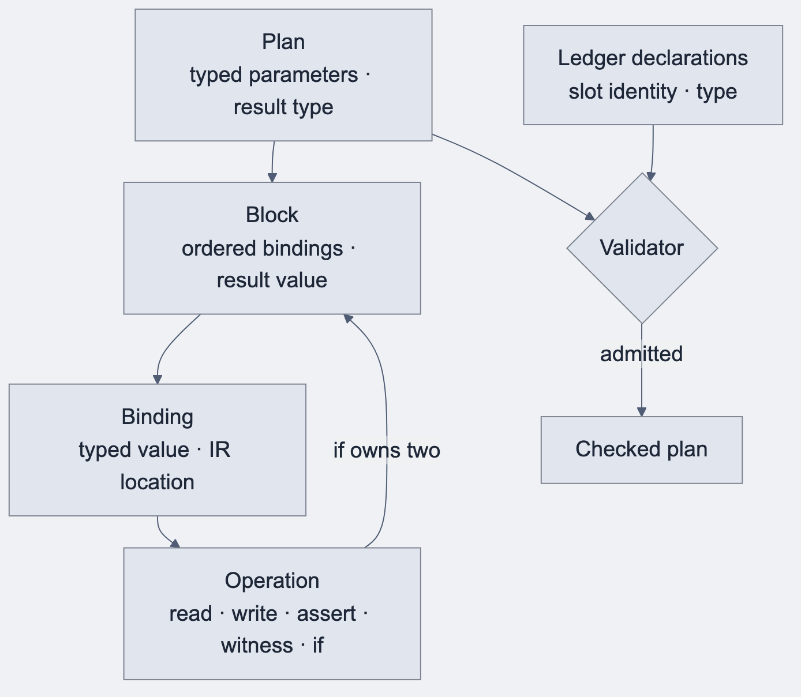
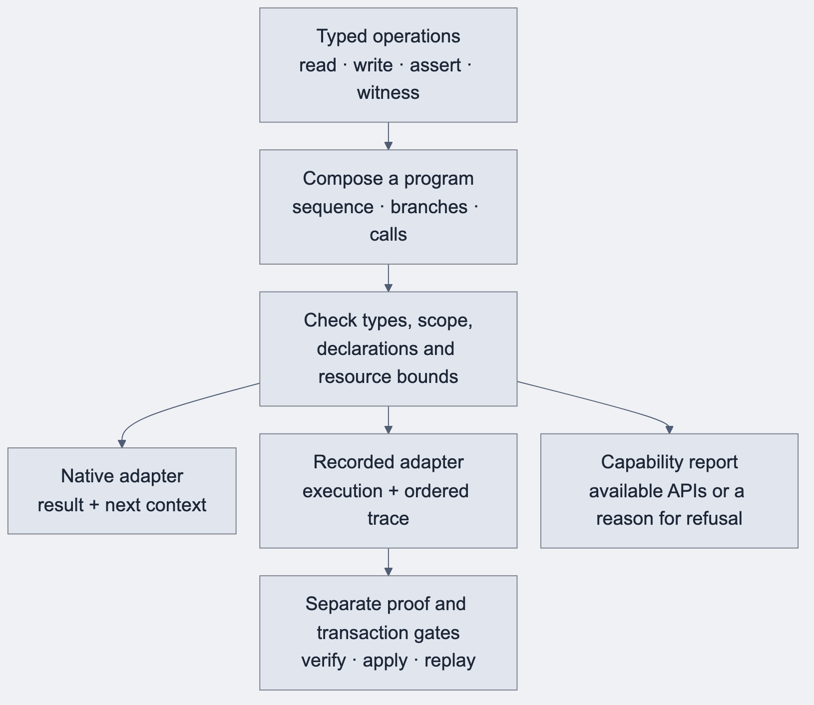
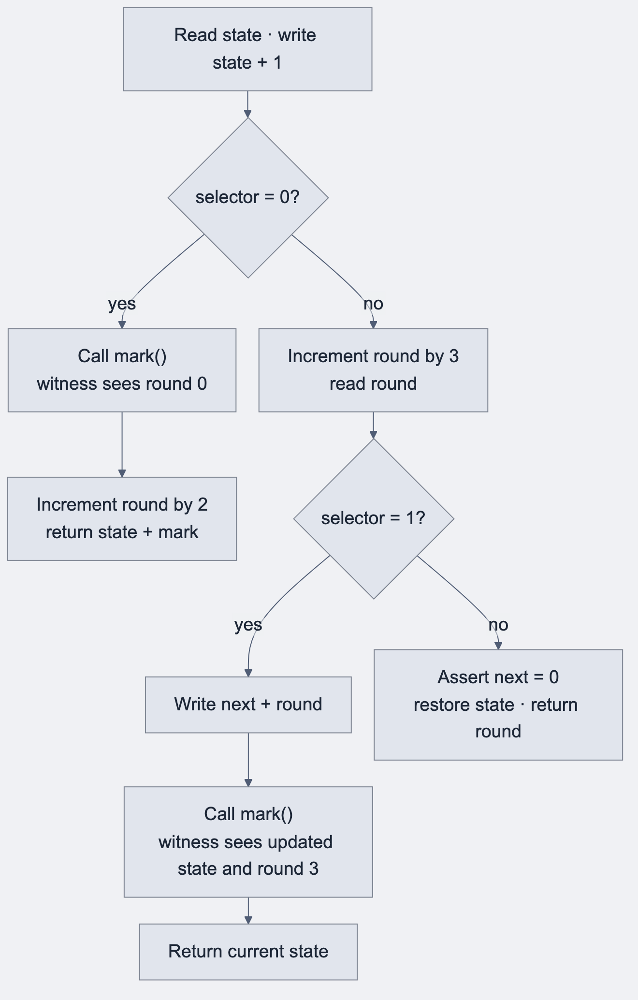

## Before · Recognize the whole circuit

The early recorder worked like a set of templates. It inspected a circuit’s parameters, ledger actions and return value, then chose a recipe for a known pattern. The recipe could enforce the exact type and physical ledger slot. A different arrangement of familiar operations could still fail to find a recipe.

[Mermaid source](../assets/diagrams/shape-model.mmd)

### Two shapes the old recorder knew

The Set insert comes from the historical oracle fixture. The Field example illustrates the saved-read pattern. Both excerpts omit their ledger declarations.

| Shape | What the recognizer looked for |
| --- | --- |
| Insert into an opaque-string Set | One string parameter, exactly one insertion of that parameter into the declared Set slot, then a Unit result. A related membership shape expected no write and returned the membership Boolean. |
| Read an old Field value, update state and return the old value | A root binding that reads a declared Field cell once, actions inside that binding, then a return of the saved Field value. |

~~~compact
// Shape 1 · The value inserted comes directly from the parameter.
export circuit addName(name: Opaque<"string">): [] {
  names.insert(disclose(name));
}

// Shape 2 · The result is the value from before the write.
export circuit replaceValue(next: Field): Field {
  const before = state.read();
  state.write(disclose(next));
  return before;
}
~~~

Here, a *shape* was a recognizer’s predicate over the existing circuit representation. The relevant entities were the circuit, its declarations, and the recording recipe selected by the recognizer. There was no common Shape object with child shapes that the compiler could assemble into a larger program.

## After · Build a plan from typed operations

The replacement describes a circuit as an ordered plan. A **block** is a list of bindings plus a result. Each **binding** pairs an operation with a typed value and an IR location. A read produces a value other operations can use. A write updates a declared slot. An *if* operation contains two blocks. The validator checks both branches, including their result types, while execution takes only the selected branch.

[Mermaid source](../assets/diagrams/operation-model.mmd)

~~~text
Illustrative plans using the integrated operation model

addName(name: OpaqueString)
_      : Unit  = SetInsert(names, name)
return Unit

replaceValue(next: Field)

before : Field = CellRead(state)
_      : Unit  = CellWrite(state, next)
return before
~~~

The integrated model gives Set insertion and membership their own typed operations, with the Set slot and element as inputs. In the Field example, the write and the return each refer to their own value, so returning the saved read stays explicit. A read, write or assertion now has the same place in the model inside a branch as it does at the top level. The validator can reject a value used before its definition or incompatible branch results at the operation that introduces the problem. In the integrated design, a shared semantic fold walks the admitted operations for native and recorded execution.

## What “algebra” means in this compiler

An algebra supplies a vocabulary of operations and rules for combining them. In this compiler, the vocabulary includes typed reads, writes, arithmetic, assertions, witness calls and control flow. The composition rules say which values are in scope, what each operation accepts and returns, and how a block produces its result.

The earlier shape recognizer answers “Does this whole circuit fit a recipe I know?” The algebraic model answers a series of smaller questions. Is this read legal for this declared slot? Does this value have the type the write expects? Do both branches produce a compatible result? Can the selected target represent the complete composition?

The syntax tree emitted at the end is a separate layer. A Rust AST represents the Rust expression or statement. The checked operation program represents the Compact behavior that expression must implement.

| Concept | Responsibility | Example |
| --- | --- | --- |
| Operation vocabulary | Name a supported action and its operands | Read a Field cell or insert an element into a typed Set. |
| Typed composition | Connect the result of one operation to later operations | Read the old Field, write the new Field, return the old one. |
| Validation | Establish scope, types, declaration identity and resource limits | Refuse a write to an incompatible slot or a value used before definition. |
| Interpreter or adapter | Give the admitted operations meaning for an execution target | Execute a write natively or execute it while building the recording. |
| Rust syntax construction | Express that admitted behavior in Rust | Build a function call, block or return expression. |

Effect composition preserves the source order. A write before a witness call can change the witness’s observation. Errors, gas, private state and the public trace also depend on order.

[Mermaid source](../assets/diagrams/algebra-capabilities.mmd)

## From two known pieces to a new composition

Suppose the compiler understands Field reads and writes and a typed conditional. We want to replace the stored value only when the caller selects that branch, while always returning the value from before the call.

The following Compact source illustrates that composition. Its admission depends on the compiler revision’s support for the listed operations and result types.

~~~compact
export circuit replaceIf(
  update: Boolean,
  next: Field
): Field {
  const before = state.read();
  if (disclose(update)) {
    state.write(disclose(next));
  }
  return before;
}
~~~

A recognizer built for the straight-line replaceValue shape can fail to match this conditional form. Extending the recipe catalogue would require checking a broader shape or adding another recognizer. Knowing the individual read and write operations alone gives that catalogue no general composition rule.

In the checked operation model, the value read at the start stays in scope through the conditional. Each branch has a Unit result, and the enclosing block returns the original Field.

~~~text
Illustrative typed plan

before : Field = CellRead(state)
_ : Unit = If(update,
    then:
        _ : Unit = CellWrite(state, next)
        return Unit
    otherwise:
        return Unit)
return before
~~~

Starting from state 4, update = true and next = 9 leaves state 9 and returns 4. With update = false, the state stays 4 and the result is still 4. The chosen branch controls the write, and the outer result keeps its own identity.

The original orderedObservation fixture below demonstrates a tested composition that the old recording path refused and the operation-plan pilot admitted.

## How capabilities change

| Question | Whole-shape recognition | Checked operation composition |
| --- | --- | --- |
| What is the unit of reuse? | A recipe for a recognized circuit family. | A typed operation together with its composition and target rules. |
| What happens when a write moves into a branch? | The new arrangement must match a supported recipe. | The branch and nested write are checked as part of one plan. |
| How is a new primitive added? | Update the relevant recipe families and their checks. | Add its representation, validation, lowering and execution behavior, then qualify its permitted compositions. |
| Where can an unsupported case be explained? | At the rejected shape or the narrower checks implemented by that recognizer. | At the unsupported operation, type, boundary or resource constraint. |
| What establishes proof support? | The applicable generated APIs and selected proof tests. | The applicable generated APIs and selected proof tests. Proof verification and ledger acceptance require their own executed checks. |

Support is also specific to types and boundaries. A Map can support structural membership or removal while lookup and write need an element codec. A collection being present in the model therefore does not make every operation on every element type available.

A new primitive still needs work. Adding its name to an enum is only the first step. The frontend must preserve its meaning, the checker must validate operands, and the runtime must execute the corresponding ledger behavior. Native and recorded adapters must agree about result, effects and ordering.

The benefit is that ordinary combinations can share those definitions. The compiler can grow through supported operations and explicit composition rules instead of accumulating a separate recipe for every useful arrangement.

## Read the capability report by stage

A capability report tells the caller which generated APIs exist for a particular stateful export. The relevant fields have separate jobs.

| Report field | What it answers |
| --- | --- |
| recorded | Can the compiler emit the complete recorded method? |
| observed_call | Can it emit the call method that binds the operation to observed contract state? |
| proof_required | Does frontend metadata say this export needs a proof? |
| recording_unavailable | What prevented complete recorded lowering, when the report supplies a reason? |

A circuit whose frontend metadata says it needs no proof can still have a recorded API. Its recording supports execution and replay, while the report marks proof applicability separately.

Pure functions have their own generated surface. A stateful capability report is therefore one view of the compiler’s support, with source admission, native behavior, recording, proof verification and transaction application checked in their respective lanes.

The operation model can report a precise missing composition while retaining other supported APIs. Users can then identify whether they need a new primitive, a new type conversion, an interface boundary or a later proof qualification step.

## Walkthrough · What a witness sees depends on order

The prototype’s original orderedObservation circuit writes state, then takes one of three paths. The old recorder refused this circuit when recording was required. The pilot admitted the same source using the checked operation plan.

~~~compact
const before = state.read();
state.write(before + 1);
if (disclose(selector) == 0) {
  const observed = mark();
  assert(disclose(observed) == 77, "unexpected mark");
  round.increment(2);
  return disclose(state.read() + observed);
}
~~~

This excerpt is the first branch. The other live witness branch increments the round and writes the new state before calling mark(). A witness is a host-supplied function. Which ledger state it observes depends on the writes already performed in the selected branch.

[Mermaid source](../assets/diagrams/witness-order.mmd)

| Prototype case | What the witness saw | Result |
| --- | --- | --- |
| Selector 0, next = 9 | State 1 and round 0 | Returns 78. State stays 1 and round ends at 2. |
| Selector 1, next = 9 | State 12 and round 3 | Returns 12. State stays 12 and round stays 3. |
| Selector 2 with next = 0 | No witness call | Returns 3 and restores state to 0. |

The cases start from the fixture’s zero state and round. The tests compared native and recorded execution with an independent TypeScript reference, including witness order, ledger state and gas. This pilot established execution and replay behavior. Its proof obligation remained separate.

## Why a versioned IR matters here

Every new node has consequences for traversal, validation, lowering, capabilities and diagnostics. Exhaustive handling makes those obligations visible. A version change can state that the boundary has changed instead of letting a consumer guess from generated text.

Source spans matter for the same reason. An unsupported child expression should point back to Compact source. A Rust panic or a generic target failure leaves users debugging the implementation rather than their program.

## Retire a recognizer with evidence

A recognizer can be removed after the new composition covers its accepted family. That requires inclusion checks across the old family's behavior, diagnostics and resource refusals. Deleting a special case after proving one happy example would lose useful support.

The retirement programme therefore worked through bounded operation families and explicit refusal controls. A capability book and shared registry made admission easier to inspect.

## Local prototype to integrated change

The October 14 storybook froze f3cef799 while final effect qualification was still open. The later integrated commit 0437c894cd069af475bd8d5b254c24cc73615a09 on October 16 records the checked-effect replacement through PR #641.

This is a good example of why a living book needs dated chapters. The old snapshot accurately described a prototype. The continuation records its later integration.

## What was solved

Operations became reusable components of larger contract behavior. Native and recorded execution could share semantic ownership, and retirement acquired a measurable obligation.

## What remained

A compositional foundation still needs specific source features, result conversions, public interfaces and proof gates. The following iterations show that work in concrete terms.

### Source trail

- [The checked operation model and validator](https://github.com/betsudo/compact/blob/0437c894cd069af475bd8d5b254c24cc73615a09/tools/compact-rust-backend/src/recorded/effect_plan/validate.rs)
- [Capability report field definitions and execution surfaces](https://github.com/betsudo/compact/blob/0437c894cd069af475bd8d5b254c24cc73615a09/doc/rust/guides/capabilities.md)

- [Operation-plan pilot, including the original Compact circuits](https://github.com/betsudo/compact/commit/9de0e55be25d66c4af54ea52798c5b2ab4c846ba)
- [Checked effect epic #508](https://github.com/betsudo/compact/issues/508)
- [IR boundary #482](https://github.com/betsudo/compact/issues/482)
- [Checked effects integration](https://github.com/betsudo/compact/commit/0437c894cd069af475bd8d5b254c24cc73615a09)
- [Shared capability book #486](https://github.com/betsudo/compact/issues/486)
