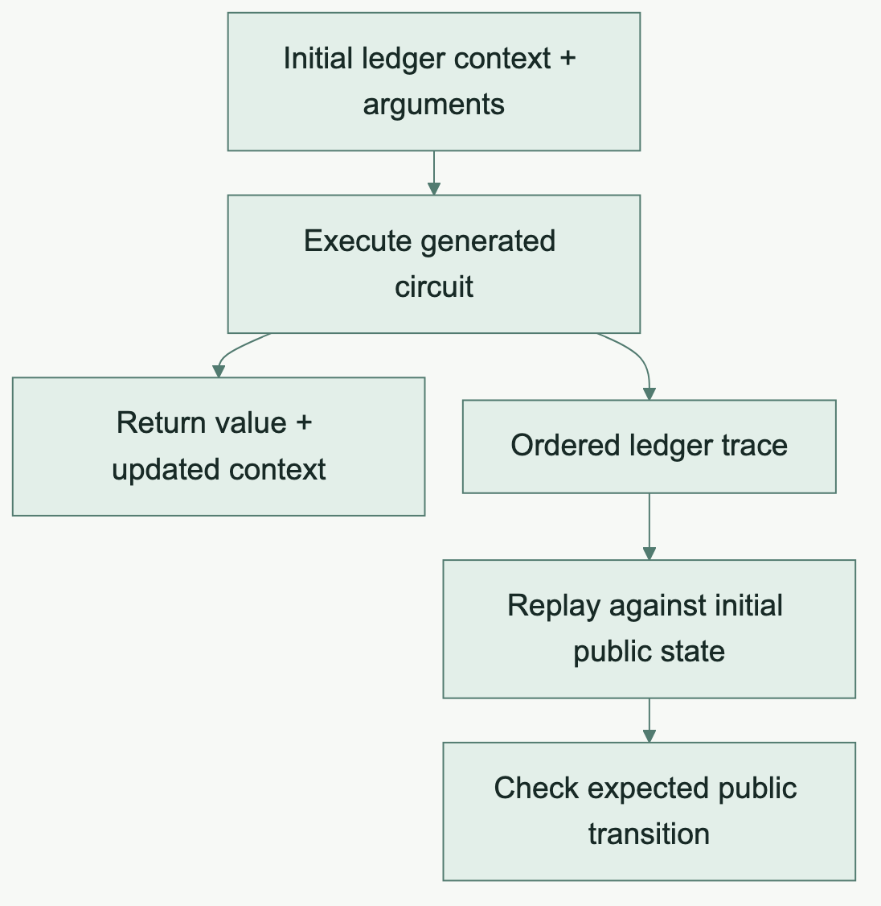

## A correct result still leaves a missing statement

A native function can return the expected value without retaining the operations needed for proof preparation. Re-running the function elsewhere also risks observing a different state or a different witness result.

The project introduced recorded execution as an explicit result. Execute against a context, retain the ordered ledger trace, and return both the native result and its recording. Replay then checks that the operations reproduce the expected public transition.

## Before and after · A counter advances from 1 to 2

### Before · Observe the answer

A caller can see the return value and the new counter. To explain the public transition later, it needs the starting context and the exact operations the circuit performed.

### After · Keep the operations from that execution

~~~text
Illustrative recording
initial round = 1
  increment round by 1
expected final round = 2
~~~

[Mermaid source](../assets/diagrams/record-and-replay.mmd)

Replay gives a second check on the public transition. A reader can see both what the call returned and how it moved the ledger. The proof and funded transaction add their own checks later.

## Give the ledger slot an owner

Typed field descriptors connect a source declaration to its physical ledger path. A CellSlot knows the value type and where the VM should read or write. Generated code supplies arguments and propagates the returned context.

That division prevents arbitrary path arithmetic from spreading across generated bodies. It also creates a reusable boundary for witness ledger views and public state inspection.

## Keep procedural macros mechanical

Derive macros add representation rules for generated types. They can implement a checked cell codec or enum representation. A body-wide macro that interprets contract semantics would hide another compiler inside generated Rust.

The selected design uses a typed runtime DSL and narrow derives. The compiler owns the source program and its admitted operations. The runtime owns execution and representation primitives.

## From a recording to a deployed operation

An observed call must bind the installed contract state and operation. The expected verifier belongs to that operation. Proof preparation needs to preserve that relationship when it constructs a statement.

Wallet-facing work added deployment and subsequent-call handoff, state observations, typed reads, and the metadata needed to build later calls from confirmed state. That made the generated API useful beyond isolated examples. A historical ABI 28 Counter observation recorded round advancing from 1 to 2. Indexed actions were bound to the final merged transaction hash and checked through a trusted node/indexer. That observation did not provide authenticated consensus finality.

## Milestone 2 closes a scoped target

By October 6 at 03c03a39a2d39c43c91143b9526ca1c2ffae706c, compactc --target rust emitted a crate, matching runtime material, proving artifacts and a manifest. The historical closeout records private IR 20, runtime ABI 49 and compiler 0.31.133.

The inventory covered 217 sources, 196 compiled roots and 755 exports. All 386 proof-required exports were available, alongside 369 non-proof exports. Sampled behavior covered 37 sources and 203 rows. Selected original proof/application cases and historical wallet observations supplied deeper evidence. Ten required remote workflows passed at the accepted head.

Availability, sampled behavior and selected proof coverage remain separate quantities. Keeping those columns prevented the closeout from turning a useful target into an unsupported whole-language claim.

### Source trail

- [Milestone 2 accepted head](https://github.com/betsudo/compact/commit/03c03a39a2d39c43c91143b9526ca1c2ffae706c)
- [Replayable execution ADR](https://github.com/betsudo/compact/blob/939b7aaaab7ff346149746dc8fce8bd29705b1d9/doc/rust/adr/0001-record-circuit-execution-as-a-replayable-ledger-trace.md)
- [Typed ledger descriptors ADR](https://github.com/betsudo/compact/blob/939b7aaaab7ff346149746dc8fce8bd29705b1d9/doc/rust/adr/0002-generate-typed-ledger-field-descriptors.md)
- [Subsequent calls from confirmed state #140](https://github.com/betsudo/compact/issues/140)
