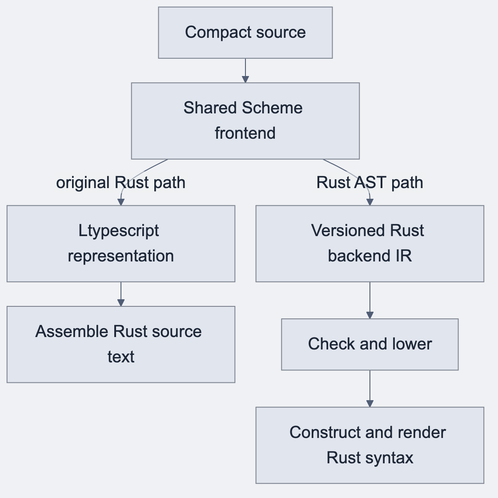

## Establishing a second compiler target

The retained original Rust backend showed that Compact could produce useful Rust. Its Scheme passes operated on TypeScript-oriented compiler representations and assembled Rust source text. The reference implementation introduced an eight-file Ltypescript emitter before the AST rebuild.

This was a practical implementation strategy. A compiler can reuse an already lowered representation and get a working target quickly. Generated crates and examples then make the missing operations visible.

## Where text emission becomes expensive

Consider a nested expression containing a ledger read, a fallible conversion and a function call. A textual emitter must preserve the source type, track the updated context, arrange error propagation, and output legal Rust syntax. If those decisions share one string-building layer, a local feature can affect many unrelated cases.

A missing clone may become an ownership error. An extra conversion can change a value's admitted range. Parentheses can make syntactically legal code with the wrong grouping. Testing generated text catches some problems after emission, but the compiler still lacks a single closed place to decide whether a construct is valid for the target.

## Why retain the original

The old backend supplied a valuable reference for the replacement. It contained behavior and generated-crate conventions that the new architecture had to preserve deliberately. Removing it would have discarded a comparative baseline precisely when the rebuild most needed one.

The project therefore used the original implementation as an oracle. The replacement could adopt a different internal design while comparing the external behavior of selected contracts.

## The decision

Keep Scheme as the shared Compact frontend. Move target-specific semantic admission into a versioned internal model. Let a Rust backend construct Rust syntax through Rust syntax-tree libraries.

This change was about ownership of decisions. It did not require a new Compact language, a replacement ledger VM, or a parallel cryptographic specification.

## Before and after · Emitting a nested calculation

[Mermaid source](../assets/diagrams/compiler-boundary.mmd)

### Before · Splice rendered expressions into text

An emitter for multiply-after-add must put parentheses around the rendered addition. Dropping them can produce valid Rust with different arithmetic.

~~~text
Illustrative text emission
"(" + emit(a) + " + " + emit(b) + ") * " + emit(c)
~~~

### After · Represent the grouping in the tree

The outer multiplication receives a checked addition as its left operand. The renderer receives that structure and can emit the required parentheses. The syntax node names below are schematic.

~~~text
Multiply(Add(a, b), c)
~~~

With 2, 3 and 4, the intended result is 20. A string that comes out as 2 + 3 * 4 would give 14. This illustrates why the project tests source behavior in addition to compiling the emitted Rust.

## Identifying an implementation before comparison

When investigating an old generated example, identify the source revision, backend line and runtime family first. Two files both called generated Rust can belong to different architectures and ABI generations. A bug fixed in the oracle is a clue for the AST line, with a separate port and test still required.

### Source trail

- [Original Ltypescript emitter introduction](https://github.com/betsudo/compact/commit/67f7cbc8b2ea3164d9fb225c7f9fd67a9aa3d552)
- [Original Rust oracle comparison](https://github.com/betsudo/compact/commit/589c92ef961ce89ac730140e81b76d4c08222a70)
- [Architecture decision research #95](https://github.com/betsudo/compact/issues/95)
